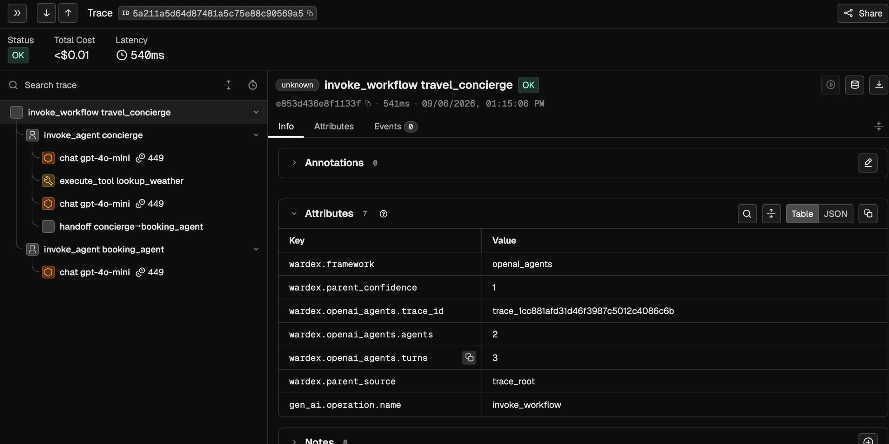

# wardex-sdk

[](https://pypi.org/project/wardex-sdk/)
[](https://github.com/wardex-labs/wardex-sdk/blob/main/LICENSE)

Open-source observability SDK for AI agents. Install it, call `init()`, and
your agent's model calls are recorded as OpenTelemetry traces, with no changes
to your agent code. On the OpenAI Agents SDK, LangGraph or the Claude Agent
SDK, its agents, tool calls and handoffs are recorded as well.

> **Beta.** Interfaces may change between 0.x releases; the rules are in
> [VERSIONING.md](https://github.com/wardex-labs/wardex-sdk/blob/main/VERSIONING.md).
> PII masking is on by default. Read what it does not catch, under
> [Data safety](#data-safety), before you send sensitive data through it.

## Why agent observability

A conventional service fails loudly: an exception, a 500, a stack trace. An
agent usually fails quietly. A run is a chain of model calls, tool calls and
handoffs between agents, and when one step starts answering differently, the
process still exits cleanly, every HTTP status is 200, and the error tracker
records nothing. The damage surfaces later and somewhere else: a retry loop
that triples the token bill, a tool that returns an empty result the next step
treats as an answer, a handoff to the wrong agent, an answer that has drifted
since the last model upgrade.

Teams usually learn about these failures from a customer complaint or an
invoice, then spend days working out when the behaviour changed and which step
changed it. Every model, prompt or tool change carries the same uncertainty.

Answering "what did the agent actually do, and since when" takes a record with
three properties:

- **Complete.** Every model call, including calls made by libraries you did
  not write, calls that failed, and calls made outside any framework.
- **Causal.** Which agent requested which tool call and which model call,
  across `asyncio` tasks, threads and services.
- **Explicit about gaps.** When part of a run could not be observed, such as
  a streamed response that never reported its token usage or a parent the
  SDK never saw, the record says so, so an empty field is never mistaken for
  a zero.

wardex-sdk is built to produce that record.

## How it works

- **It reads model traffic where it crosses the socket.** Inside your process,
  the SDK observes the traffic your code produces over HTTP/1.1, HTTP/2,
  WebSocket, gRPC (grpclib) and MCP stdio. Calls to recognised model providers
  are always recorded; other traffic is recorded while it runs inside a wardex
  span. For OpenAI Chat Completions, Responses and Embeddings and for Anthropic
  Messages, model, messages, parameters and token usage come from the bytes
  the provider actually received and returned, streaming included. Two cases
  are read another way: the Claude Agent SDK makes its model calls from a CLI
  subprocess, so its adapter rebuilds them from that process's output, and
  Responses over WebSocket is recorded as a marked connection whose calls are
  left unread.
- **It rebuilds the run tree from in-process context.** Parent links come from
  context propagation inside your process, so a model call made deep inside a
  tool lands under that tool even when no framework hook reports it. Each
  link records how it was established and with what confidence, and a link
  the SDK cannot back carries a marker instead.
- **It marks what it could not see.** An incomplete span carries a named
  marker in `wardex.limitations`, for example `stream_usage_unavailable` when
  a streamed response carried no usage block, so its token counts are absent.
  A loss that cannot ride on a span is counted in-process, and export, buffer
  and parser losses are also reported once on the `wardex_sdk` logger.
- **It masks before export.** Secrets and personal data are masked inside your
  process, before a byte is sent, and each masked span records what was
  replaced and by which rule.
- **It speaks OpenTelemetry.** Spans follow the OpenTelemetry `gen_ai`
  semantic conventions and export over OTLP/HTTP to any compatible backend, or
  to the wardex receiver.
- **It stays out of your way.** The core is Rust, the wheel has no runtime
  Python dependencies, parsing runs on the SDK's own worker threads, and
  nothing the SDK does after `init()` raises into your code. The measured
  cost is under [Overhead](#overhead).

## Next to the tools you are evaluating

**Langfuse, LangSmith, Arize Phoenix.** These platforms store, search and
evaluate traces. Their integrations usually live in your code as a client
wrapper, a decorator, an instrumentation package or a framework callback, and
a trace contains what that integration chose to report. wardex-sdk is a
collector that exports standard OTLP. Langfuse and Phoenix are tested
destinations, so a team can keep the platform it already uses and change only
how the data is collected.

**LangGraph and other agent frameworks.** wardex records LangGraph runs
without callbacks or `LangChainTracer`: one span per graph run, one per node,
one per tool call a `ToolNode` dispatches, with every model and HTTP call
underneath placed by context. The OpenAI Agents SDK and the Claude Agent SDK have adapters as well,
and each installs itself when your application imports its framework. On a
framework with no adapter, model calls to recognised providers are still
captured with their token usage and model ids, and a few decorators add the
structure.

**Building it in-house.** A wrapper around the model client is quick to write.
The work that follows is what this SDK already does: reading streamed responses and
their usage, keeping parent links correct across `asyncio.gather` and shared
HTTP/2 connections, carrying context into worker threads, masking credentials in URLs, JSON bodies and tool
arguments before they leave the process, bounding memory under load, and
reporting explicitly when any of it failed. The SDK is Apache-2.0, so every
one of those decisions is readable in the source.

## Install

```bash
pip install wardex-sdk
```

Python 3.10 or newer. Prebuilt wheels cover Linux with glibc (x86_64,
aarch64), macOS (x86_64, arm64) and Windows (x86_64), so nothing compiles on
install. Other platforms, such as Alpine (musl), have no wheel yet.

## Quickstart

Point the SDK at any OpenTelemetry backend that accepts OTLP/HTTP (Langfuse,
Phoenix, an OTel Collector). wardex appends `/v1/traces` to the address
unless its path already ends with it.

```bash
export WARDEX_ENDPOINT=http://127.0.0.1:6006   # a local Phoenix
```

```python
import wardex_sdk as wardex

wardex.init()

# Your agent code, unchanged.

wardex.close()  # optional: spans also flush every 5 seconds and at exit
```

To check the install, run `python -m wardex_sdk doctor`. It reads the same
environment as your app, sends one test span, and ends with
`OK: <url> accepted the test span.` (exit code 0) or `FAIL:` and the fix
(exit code 1). In your app, the first delivered export prints one line on
stderr: `[wardex] first export delivered: N span(s) accepted by <url>`.

For Langfuse, use its OTLP base URL and its key pair as HTTP Basic auth:

```bash
export WARDEX_ENDPOINT=https://cloud.langfuse.com/api/public/otel
export OTEL_EXPORTER_OTLP_HEADERS="Authorization=Basic%20$(printf '%s' "$LANGFUSE_PUBLIC_KEY:$LANGFUSE_SECRET_KEY" | base64 | tr -d '\n')"
```

A host that already exports OTLP needs no new variable:
`OTEL_EXPORTER_OTLP_ENDPOINT` and `OTEL_EXPORTER_OTLP_HEADERS` are read as
well. Capture starts at `init()` (`intercept=False` turns it off).
`WARDEX_DISABLED=1` turns wardex off without a code change.

Where the data goes is decided by what you configured, and nothing else:

| You set | Data goes to |
|---|---|
| `WARDEX_ENDPOINT`, an OTel endpoint variable, or `backend=BackendConfig(endpoint=...)` | that OTLP/HTTP collector, authenticated by `OTEL_EXPORTER_OTLP_HEADERS` or `BackendConfig(headers=...)` |
| `WARDEX_API_KEY` or `BackendConfig(api_key=...)` | the hosted wardex receiver the key's region names |
| the key plus `WARDEX_BASE_URL` or `BackendConfig(base_url=...)` | a self-hosted wardex receiver at that URL |
| `transport=` | that transport, always |
| none of these | nowhere: `init()` installs nothing and says so once on stderr |

To capture without exporting, in a test suite for example, pass
`transport=wardex_sdk.NoOpTransport()`. A setting that loses to another is
announced: as a `WardexConfigWarning` when both are arguments to `init()`,
as a `[wardex]` line on stderr when one came from the environment. A bad
environment value never stops your app: wardex names the variable and the
fix on stderr and exports nothing. The same value as an argument raises. The
`api_key` rows are on the main branch and are not available in the current
release.

## See a real trace

The [openai-agents example](https://github.com/wardex-labs/wardex-sdk/blob/main/examples/README.md)
runs two agents, a function tool and a handoff against a local Phoenix,
started with one `docker run` as its walkthrough shows. The script makes six
short `gpt-4o-mini` calls against your OpenAI key.

```bash
git clone https://github.com/wardex-labs/wardex-sdk && cd wardex-sdk
python3 -m venv .venv-quickstart && source .venv-quickstart/bin/activate
pip install "wardex-sdk>=0.6.0b1" "openai-agents>=0.22,<0.24"
export OPENAI_API_KEY=sk-...                             # the framework's own requirement
export WARDEX_ENDPOINT=http://127.0.0.1:6006/v1/traces   # a local Phoenix
python examples/openai_agents_quickstart.py
```

<!-- Absolute URL on purpose: this file is also the PyPI long description
     (readme = "README.md" in sdks/python/pyproject.toml), where a relative
     path renders as a broken link. The trade-off is that the image and the
     docs links 404 on branches and in PR views until they are on main. -->


No decorator, callback or processor was added to the agent code to get this
tree.

## Frameworks

| Framework | What becomes a span |
|---|---|
| OpenAI Agents SDK (tested on `openai-agents` 0.22.x, 0.23.x) | each run, agent, function tool, handoff and guardrail; model calls read from the wire |
| LangGraph (tested on `langgraph` 1.2.x) | each graph run, node and `ToolNode` tool call, including subgraphs and the functional API |
| Claude Agent SDK (tested on `claude-agent-sdk` 0.2.x) | agent turns and model calls, with tool calls correlated |
| Codex CLI (`codex exec`, run as a subprocess) | each run, with its prompt, answer, tool calls and the turn's token usage; with `CodexExecConfig(otel_bridge=True)`, one span per model call with its model and timing |
| Any other framework, or your own loop | model calls with model, messages and token usage; decorators add the structure |

An adapter installs when your application imports its framework, before or
after `init()`, and shows as `waiting_for_import` until then. `init()`
imports no framework itself. The Codex adapter installs at `init()` when
`codex` is on `PATH`. `AdaptersConfig` selects and configures them.

Each adapter is tested against the framework releases in the table above. On
any other release it still installs and records, and says so once on stderr
with the installed version, the tested range and the pin that gets back to it,
because a framework release can change what an adapter records without
changing anything the adapter can check. An adapter whose framework is
installed but not in a shape it recognizes does not install, and says that
once too. `wardex.diagnostics()` returns each adapter's state, the framework
version it found and whether that version was tested, at any time:

```python
for adapter in wardex.diagnostics().adapters:
    print(adapter.name, adapter.state.value, adapter.version, adapter.measured)
```

wardex never raises into your application, so what it misses (spans a full
buffer evicted, an adapter that did not install or runs on an untested
release, an error inside wardex itself, exports held for a retry because the
collector did not take them) is one `[wardex]` line on stderr, or
one record on the `wardex_sdk` logger when your app configures logging. In
your test suite you can make it a failure instead:

```bash
pytest --wardex-strict
```

A test during which wardex lost something fails with what was lost, how many
and what to do. Accept one on purpose with
`--wardex-strict-allow=queue_overflow`, or scope it as `REASON:SUBJECT`.
Outside pytest, call `wardex.testing.assert_no_capture_gaps()` at the end of a
run; `wardex.diagnostics().losses` reads the same counts at any time. Both
fail when `init()` installed nothing. `python -m wardex_sdk explain NAME`
says what a loss reason or a `wardex.limitations` marker means, and
[LIMITATIONS.md](https://github.com/wardex-labs/wardex-sdk/blob/main/LIMITATIONS.md)
lists them all. For a bug report, paste `wardex.diagnostics().report()`.

The Codex adapter only reads what your process already exchanges with
`codex exec` — the prompt passed to `communicate()` and the `--json` events
on stdout — and
never changes the command. That stream names neither the model nor how many
times it was asked, so the run carries the turn's total and says so. With
`otel_bridge=True` the adapter adds a trace exporter override and a
`TRACEPARENT` to each `codex exec` and reads each model call from Codex's own
traces; it leaves alone a run whose command, environment or Codex config
already sets up telemetry. Verified against `codex-cli` 0.160.0.

The Claude Agent SDK adapter reads every session's CLI output, and adds
observation-only hooks to the options of each `query()` call and
`ClaudeSDKClient` it wraps; the hooks are what give each sub-agent a span of
its own. It wraps `claude_agent_sdk.query` as a module attribute, so a
`from claude_agent_sdk import query` that runs before `init()` keeps the
unwrapped function, and so does a client constructed before it. Such a session
is still recorded, from the CLI's output alone: its root span carries
`instrumentation_degraded`, and a warning on stderr says so once. Call `init()`
before that import, or call `claude_agent_sdk.query(...)` through the module.

## Adding structure to your own code

```python
import wardex_sdk as wardex


@wardex.agent(name="researcher")
def research(question: str): ...


@wardex.tool(name="search")
def search(query: str):
    wardex.current_span().set_input({"query": query})
    ...


wardex.set_user("user-42")
wardex.set_account("acme-corp")  # your own customer, as wardex.account.id
with wardex.conversation("support-chat", id="session-123"):
    research("Which plan includes SSO?")
```

The decorators produce `invoke_agent researcher` and `execute_tool search`
spans (`@workflow` and `@step` produce `invoke_workflow` and
`execute_step`); without `name=`, the name is the qualified function name.
On a generator the span lasts from the first item to the last. Every span
inside a `conversation()` block, model calls included, carries
`gen_ai.conversation.id`, and the spans after `set_user` and `set_account`
carry `user.id` and `wardex.account.id`. `set_input()` on a tool span
exports as `gen_ai.tool.call.arguments`. An exception that leaves a span is
recorded on it, and your code still receives the same exception.
Hand-started threads need `wardex.bind_context(fn)` to carry the context;
`asyncio` tasks inherit it.

## Data safety

Masking is on by default and runs in your process before export. It covers
e-mail addresses, North American phone numbers, South Korean mobile numbers
(`010-2481-7730` with hyphens, en dashes, spaces, dots or nothing between the
groups, with `+82`, `(+82)` or `0082` in front, or as `(010) 2481-7730`),
card numbers, US SSNs, IP addresses, IBANs, bank routing numbers, credential
formats (`sk-…`, `AKIA…`, `ghp_…`, JWTs, PEM private keys and more), and any
value passed under a secret-looking name such as `api_key` or `password`,
whether it sits in a URL, a JSON body, a form field or a span attribute.
Version strings such as `numpy==1.26.4.1` are kept, and so are private
addresses in `server.address` and the host of `url.full`. Argument names
stay readable, and each masked span records how many values were replaced
and by which rule. If masking itself fails on a span, the span is never sent
unmasked: it leaves with only its ids, kind and timing, named
`[PII_FILTER_ERROR]` and marked `pii_filter_failed`, and is counted under
`internal_sdk_error` in `wardex.diagnostics().losses` with one log line.
That is a wardex bug; please report it.

```python
from wardex_sdk import PIIConfig

wardex.init(
    pii=PIIConfig(
        extra_secret_names={"x_corp_auth"},  # also masks xCorpAuth, X-Corp-Auth
        reveal_names={"page_token"},  # kept, unless the value looks like a credential
    ),
)
```

What masking does not catch:

- a secret under an ordinary name with no recognisable shape, such as
  `{"value": "hunter2"}`;
- a phone number in any other form: another country's (`+44 20 7946 0958`),
  a South Korean landline (`02-2481-7730`), a country code with neither `+`
  nor `00` (`82-10-2481-7730`), full-width digits, or a number run into
  letters or an underscore (`user_01024817730.json`);
- a secret name with an escape inside it, such as `pass\u0077ord=…`;
- `name: value` in prose or YAML, and XML such as `<password>…</password>`;
- a credential inside a URL path, such as `/bot<token>/sendMessage`;
- payloads that are not text, and bodies compressed with anything other than
  gzip or zlib;
- anything read before the encoder runs: `before_send_envelope`,
  `ConsoleTransport` and a transport that serializes envelopes itself all see
  data before masking.

## Reference

### Environment variables

An argument to `init()` wins over its environment variable.

| Variable | What it sets |
|---|---|
| `WARDEX_ENDPOINT`, then `OTEL_EXPORTER_OTLP_ENDPOINT` | the OTLP/HTTP collector; `/v1/traces` is appended unless the path ends with it |
| `OTEL_EXPORTER_OTLP_TRACES_ENDPOINT` | the collector's trace URL, used as written; it wins over `OTEL_EXPORTER_OTLP_ENDPOINT` |
| `OTEL_EXPORTER_OTLP_HEADERS` | the collector's request headers, `key=value,key2=value2`, percent-encoded |
| `WARDEX_API_KEY`, `WARDEX_BASE_URL` | the wardex project key, and a self-hosted receiver for it |
| `WARDEX_SERVICE_NAME`, `WARDEX_RELEASE`, `WARDEX_ENVIRONMENT` | `service_name`, `release`, `environment`; else read from `OTEL_SERVICE_NAME` and `OTEL_RESOURCE_ATTRIBUTES` |
| `WARDEX_DEBUG`, `WARDEX_PII` | `1` turns `debug` on; `off` turns masking off |
| `WARDEX_DISABLED`, `OTEL_SDK_DISABLED` | `WARDEX_DISABLED=1` or `OTEL_SDK_DISABLED=true`: `init()` installs nothing |

`OTEL_EXPORTER_OTLP_PROTOCOL=grpc` next to an OTel endpoint makes wardex
export nothing and say why: it speaks OTLP over HTTP only.

### Deployment notes

- A serverless runtime can freeze the process before the 5-second flush, so
  call `wardex.flush()` before the handler returns.
- `os.fork()` is handled: the child exports its own spans.
- On uvloop, plaintext `http://` calls are not captured and `https://` calls
  are. wardex says so once. Use TLS, or run uvicorn with `--loop asyncio`.
- gevent is not supported, and wardex says so once.
- Another OpenTelemetry LLM instrumentation (OpenInference, OpenLLMetry,
  Logfire) records each model call again in a separate trace, and wardex
  warns once. For one trace, make the calls inside an active OpenTelemetry
  span and inside `with wardex.continue_from_otel():`.

### Model providers

Model calls are read from the bytes for OpenAI Chat Completions, Responses
and Embeddings and for Anthropic Messages, on any host, and for a streamed
reply on any path. `gen_ai.provider.name` comes from the host (`openai`,
`anthropic`, `azure.ai.openai`, `groq`, `deepseek`, `mistral_ai`, `x_ai`,
`perplexity`, `cohere`, `gcp.gemini`, `gcp.vertex_ai`, `aws.bedrock`); any
other host gets none and the `provider_inferred` marker. Gemini and Vertex
AI `generateContent`, Bedrock Runtime, Ollama's `/api/chat` and
`/api/generate`, and Cohere and Mistral calls on other paths are not parsed
yet. Outside a span they are counted under `mode_refused` and said once per
API; record them inside `wardex.span(...)` or with
`capture_mode=CaptureMode.ALL`.

### Overhead

Measured on one arm64 macOS machine at a load average of about 2, not a
guarantee. An HTTP request wardex does not keep (outside any span, not a
model call) adds about 35 to 40 µs of CPU on the calling thread for a small
or a 1.2 MB plaintext reply, and about 95 µs for 1.2 MB over TLS; the body
is not stored or copied. `init()` takes about 35 ms with three agent
frameworks installed and none imported. A `wardex.span()` block or a
decorated call costs about 23 µs. To measure on your machine, run
`uv run python sdks/python/tests/bench_host_overhead.py` in a clone.

## Status

Available today: the Python SDK, the three framework adapters above, OTLP
export to any OpenTelemetry backend, and masking on by default. Not yet: an
adapter for plain LangChain LCEL chains, and SDKs for Node/TypeScript and Java.

`wardex_sdk.__version__` reports the installed version. Version semantics and
the deprecation policy are in
[VERSIONING.md](https://github.com/wardex-labs/wardex-sdk/blob/main/VERSIONING.md);
release notes are in
[CHANGELOG.md](https://github.com/wardex-labs/wardex-sdk/blob/main/CHANGELOG.md).
To build from source or contribute, see
[CONTRIBUTING.md](https://github.com/wardex-labs/wardex-sdk/blob/main/CONTRIBUTING.md).

## License

Apache-2.0. See [LICENSE](https://github.com/wardex-labs/wardex-sdk/blob/main/LICENSE)
and [NOTICE](https://github.com/wardex-labs/wardex-sdk/blob/main/NOTICE).

"Wardex" is a trademark of Wardex Labs.
